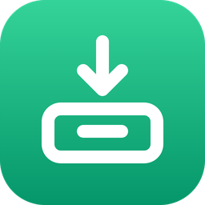
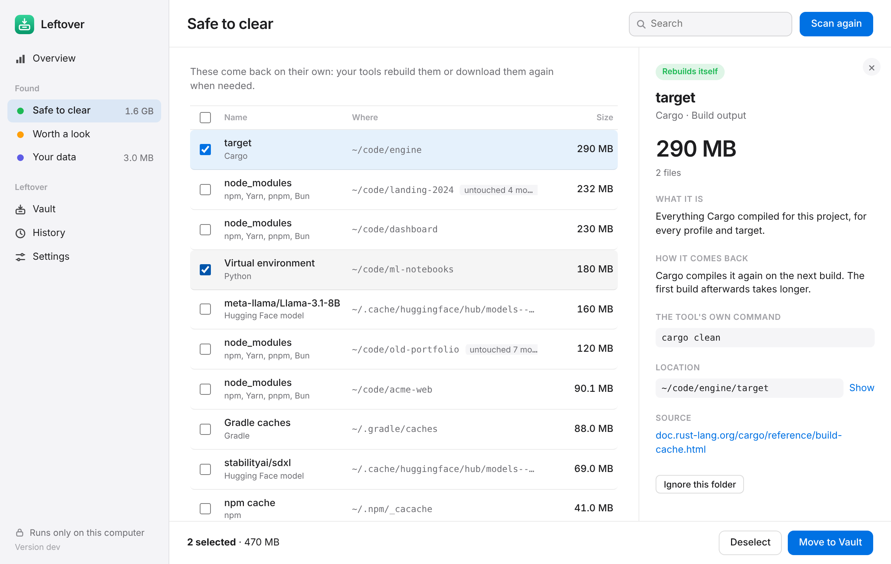

[](https://leftover.openrepos.org/)

<p align="center">
  
</p>

<h1 align="center">Leftover</h1>

<p align="center">
  <b>Know what it is. Then let it go.</b><br>
  A local-first disk cleaner for developers. Leftover explains every cache, build folder and AI model on your machine, and moves what's safe to a 14-day vault instead of deleting it. Nothing leaves your computer.
</p>

<p align="center">
  <a href="https://github.com/MaiSamayTha/leftover/actions/workflows/ci.yml"></a>
  
  
  
  
</p>

<p align="center">
  
</p>

---

`node_modules` in projects you haven't opened in months. Python environments whose interpreter is long gone. Gigabytes of model weights, Xcode's Derived Data, old Gradle and Playwright versions, package caches from every tool you've ever tried. Your OS lumps it all into "System Data" or "Developer" and offers no way to tell what's safe.

Leftover finds it, tells you what each item is and how it comes back, and clears only what you pick, into a vault you can restore from.

## What makes it different

- **It explains, it doesn't guess.** Every item has a plain-language explanation, the tool that made it, how it comes back, and a link to the tool's own documentation. Anything without a documented source is shown as *worth a look* and is never offered for cleaning.
- **Nothing is deleted until you're sure.** Cleaning is a rename into a vault on the same drive: instant, and exactly reversible for 14 days. If your tools already rebuilt something (say `npm install` ran again), restoring puts it beside the new copy instead of overwriting it.
- **It knows your projects.** Dependencies and build output are tied to the project they belong to, with how long since you last worked on it, so `leftover clean --idle 90` clears only what you've stopped using.
- **It breaks big things down.** See each model inside Ollama's folder (and which ones share layers), each Hugging Face model, each old Xcode device-support version, and what `docker system df` says is reclaimable inside Docker's disk image.
- **It's private by construction.** One binary, no account, no analytics, no update checks, no network code. The desktop window is served only to your machine on `127.0.0.1` with a per-launch key.
- **It's small and auditable.** Pure Go standard library, no third-party dependencies. CI fails if one is ever added.

## What it finds

| | Rebuilds itself / downloads again (safe to clear) | Worth a look | Your data (never touched) |
|---|---|---|---|
| **JavaScript** | `node_modules`, `.next`, `.nuxt`, `.svelte-kit`, `.turbo`, `.parcel-cache`, npm / Yarn / Bun / Deno caches, node-gyp headers | pnpm store | |
| **Python** | virtual environments with a requirements file, `__pycache__`, pytest / mypy / Ruff caches, `.tox`, pip / uv / Poetry caches | environments with no requirements file, Conda package cache | Conda environments |
| **AI models** | Hugging Face models and datasets, Ollama models, PyTorch Hub, Whisper | LM Studio models | |
| **Rust, Go, JVM** | Cargo `target` and registry, Go build and module caches, Gradle caches and wrappers, Maven repository and `target` | | |
| **Apple and mobile** | Xcode Derived Data, device support files, simulator caches, CocoaPods, SwiftPM, Homebrew downloads, Android system images | | Simulators, Xcode archives, Android emulators |
| **More** | NuGet, .NET `bin`/`obj`, Composer, Bundler, Dart/Flutter, Terraform providers, Playwright / Puppeteer / Cypress / Electron downloads, JetBrains caches | VS Code and Cursor caches | Docker's disk image, coding-agent history |

Every rule lives in [`internal/rules/catalog`](internal/rules/catalog) as readable JSON. Adding a tool needs no Go code; see [docs/RULES.md](docs/RULES.md). Run `leftover rules` to list them all.

## Install

### Download the app

No terminal needed. Get it from the [website](https://maisamaytha.github.io/leftover/#download), or straight from the latest release:

| | Download | Then |
|---|---|---|
| **macOS** (Apple silicon and Intel) | [Leftover.dmg](https://github.com/MaiSamayTha/leftover/releases/latest/download/Leftover.dmg) | Open it and drag Leftover onto Applications |
| **Windows** (64-bit and ARM) | [Leftover-Setup.exe](https://github.com/MaiSamayTha/leftover/releases/latest/download/Leftover-Setup.exe) | Run it; Leftover appears in the Start menu. No admin rights needed |
| **Linux** (Debian, Ubuntu…) | [x86-64 .deb](https://github.com/MaiSamayTha/leftover/releases/latest/download/leftover-linux-amd64.deb) · [ARM64 .deb](https://github.com/MaiSamayTha/leftover/releases/latest/download/leftover-linux-arm64.deb) | Double-click to install, then open Leftover from your app menu |

The first time you open it, macOS and Windows ask you to confirm, because Leftover isn't signed with a paid certificate yet; [here's what to click](#cant-be-opened-or-windows-protected-your-pc). The Windows installer and the `.deb` also add the `leftover` command to your terminal.

### From the terminal

**macOS and Linux**

```sh
curl -fsSL https://raw.githubusercontent.com/MaiSamayTha/leftover/main/scripts/install.sh | sh
```

**Windows** (PowerShell)

```powershell
irm https://raw.githubusercontent.com/MaiSamayTha/leftover/main/scripts/install.ps1 | iex
```

Both scripts download the latest release, check it against the release's published SHA-256 checksums before installing anything, need no admin rights, and add a launcher to your Applications folder, app menu or Start menu. Prefer to do it by hand? Grab an archive from [Releases](https://github.com/MaiSamayTha/leftover/releases) and verify it against `checksums.txt`.

**Homebrew** (macOS and Linux)

```sh
brew tap maisamaytha/leftover https://github.com/MaiSamayTha/leftover
brew install maisamaytha/leftover/leftover
```

**Scoop** (Windows)

```powershell
scoop bucket add leftover https://github.com/MaiSamayTha/leftover
scoop install leftover/leftover
```

The formula and manifest live in this repository and are updated by the release workflow, with the same checksums.

### "Can't be opened" or "Windows protected your PC"

Leftover isn't signed with an Apple or Microsoft certificate yet, so the first time you open a downloaded copy your OS asks you to confirm. You only do this once. The install scripts, Homebrew and Scoop don't trigger it.

- **macOS:** when it says Apple could not verify Leftover, click **Done**. Then open **System Settings → Privacy & Security**, scroll down and click **Open Anyway** next to the message about Leftover. (On macOS 14 and earlier, right-clicking the app and choosing **Open** also works.)
- **Windows:** on the "Windows protected your PC" prompt, click **More info**, then **Run anyway**.

Either way, check the archive against `checksums.txt` first. Every change is listed in the [changelog](CHANGELOG.md).

### Build it yourself

You need Go 1.24 or newer.

```sh
git clone https://github.com/MaiSamayTha/leftover.git
cd leftover
go build ./cmd/leftover
./leftover
```

## Use it

Run `leftover` with no arguments, or open it from your launcher, to get the app. Everything is also available from the terminal:

```
leftover scan                    find and explain what's using space
leftover scan --idle 90          only projects untouched for 90 days
leftover why ~/code/app/target   explain any folder
leftover clean                   review the plan, then move safe items to the vault
leftover clean 3fa1c09e2b7d      clean specific items by id
leftover vault                   see what's in the vault and how long it has left
leftover vault restore <id>      put something back
leftover vault empty --expired   free the space from expired items now
leftover history                 every move, restore and deletion Leftover has made
leftover ignore add ~/work/big   never look inside a folder
leftover rules                   everything Leftover recognises
leftover where                   where Leftover keeps its own files
```

Add `--json` to `scan`, `why`, `vault`, `history` or `rules` for machine-readable output. `clean` always shows its plan and asks first; it won't run unattended unless you pass `--yes`.

A note on space: moving into the vault is a rename, so the space comes back when the vault is emptied, after 14 days (automatically, at the start of the next scan) or right away with **Empty Vault** / `leftover vault empty`.

## Safety rules

These are enforced in code and covered by tests:

1. Scanning only reads. Symlinks and junctions are never followed, and scans never cross onto another drive.
2. Only items whose rule cites a documented source can be cleaned. *Worth a look* and *your data* are never moved.
3. Cleaning never deletes. It renames into a vault on the same drive and never copies between drives.
4. A manifest is written before anything moves, so even an interrupted clean can be restored. Items with several folders move all-or-nothing.
5. Your home folder, anything above it, drive roots, Leftover's own data and the vaults themselves can never be moved, whatever a rule says.
6. Every change is logged.

## Privacy

Leftover runs entirely on your computer. It has no account, collects nothing and makes no network requests. The only writes outside its own data folder are the moves you confirm. The full statement is on the [privacy page](site/privacy.html).

## Project layout

```
cmd/leftover        the command line and the entry point for the app
internal/rules      the rule format, path expansion and the catalogue (catalog/*.json)
internal/scan       the read-only scanner, folder sizer and per-tool breakdowns
internal/vault      quarantine, restore, emptying and the history log
internal/app        the layer the CLI and the window share
internal/ui         the local server and the window (web/)
site                the website, static files only
scripts             installers and the end-to-end check
```

`go test ./...` runs the unit tests, and `sh scripts/e2e.sh` drives the real binary through a full scan, clean, restore and empty in a throwaway home folder.

## Contributing

Bug reports with the path and tool version are the most useful thing you can send, especially for verdicts that look wrong. New rules are very welcome. See [CONTRIBUTING.md](CONTRIBUTING.md).

## License

[MIT](LICENSE) © 2026 Samay
